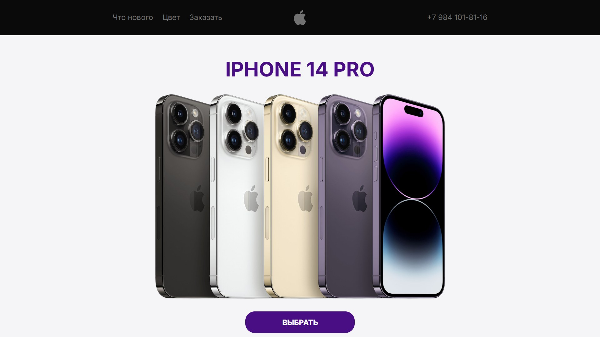

# 📱 iPhone 14 Pro — продуктовый лендинг

Адаптивный лендинг-презентация iPhone 14 Pro, свёрстанный с нуля по макету Figma. Продуктовая подача в стиле Apple: крупный первый экран, преимущества, выбор цвета и форма заказа.

[>>> Открыть сайт <<<](https://pavelreb.github.io/Iphone_14_Pro/)



## ✨ Что внутри

- 🖥️ **Первый экран** с крупным рендером iPhone и кнопкой «Выбрать»
- 🆕 **Что нового** — A16 Bionic, камера 48 Мп, ProMotion 120 Гц
- 🎨 **Выбери свой цвет** — Silver, Deep Purple, Gold, Space Black
- 🛒 **Форма заказа** — имя и телефон, CTA-блок
- 🍔 **Бургер-меню** и плавный скролл к якорям

## 🛠️ Технологии

| Технология | Применение |
|------------|-----------|
| **HTML5** | Семантическая разметка |
| **CSS3 (Flexbox / Grid)** | Раскладка секций |
| **Media Queries** | Адаптив под десктоп, планшет и мобильные |
| **JavaScript (ES6)** | Бургер-меню и плавный скролл с easing-анимацией |
| **Figma** | Вёрстка по макету |

## 🚀 Запуск

Сборка не требуется — достаточно открыть `index.html` в браузере или развернуть на любом статическом хостинге (GitHub Pages, Netlify, Vercel).

## 📁 Структура

```
Iphone_14_Pro/
├── index.html      # Разметка страницы
├── css/
│   ├── main.css    # Основные стили
│   ├── media.css   # Адаптив
│   └── reset.css   # Сброс стилей
├── js/
│   └── main.js     # Меню и скролл
└── img/            # Изображения и SVG
```
